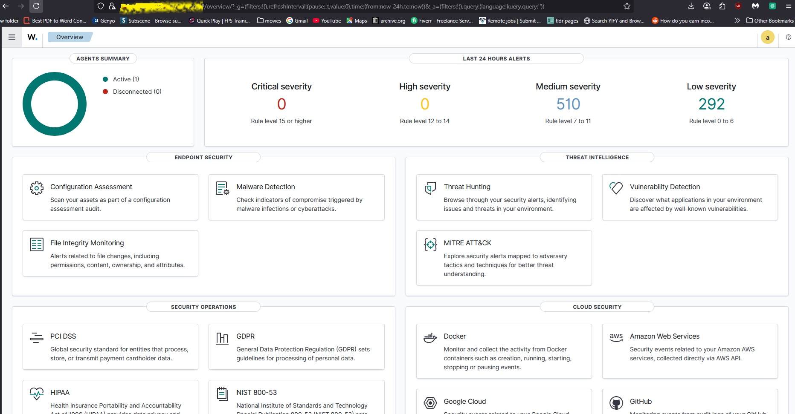
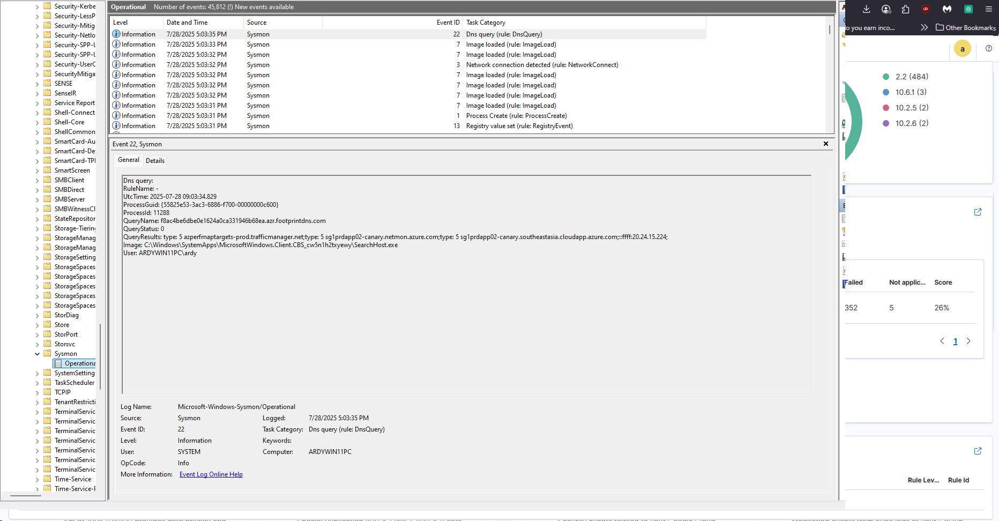
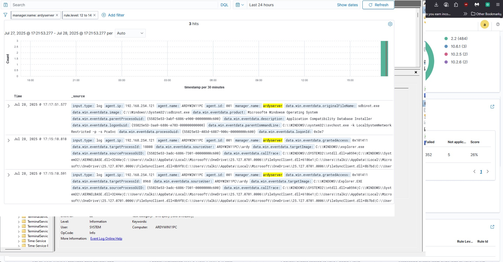
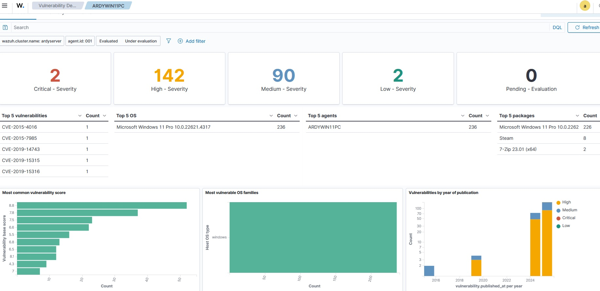

# Wazuh SIEM & Endpoint Security Operations Lab

## Executive Summary
Engineered and deployed an enterprise-grade **Wazuh SIEM (Security Information and Event Management)** and **XDR (Extended Detection and Response)** monitoring infrastructure. Integrated **Sysmon (System Monitor)** endpoint auditing, real-time **File Integrity Monitoring (FIM)**, automated **Vulnerability Scanning**, and **Security Configuration Assessment (SCA)** benchmarks across Windows endpoints to detect threats, unauthorized modifications, and system vulnerabilities in real time.

---

## Architecture & Core Components
- **SIEM Manager:** Wazuh Server (`ardyserver` | Active Manager Service)
- **Endpoint Agent:** Windows 11 Host (`ARDYWIN11PC` | Agent ID: `001` | IP: `192.168.254.121`)
- **Advanced Telemetry:** Microsoft-Windows-Sysmon/Operational Event Logging
- **Compliance & Security Frameworks:** CIS Benchmark (Windows 11 Enterprise v3.0.0), MITRE ATT&CK Mapping, CVE Vulnerability Index

---

## Technical Implementation Highlights

### 1. Wazuh SIEM Manager Daemon Service Status
Deployed and verified the core Wazuh Manager service daemon (`wazuh-manager.service`) running on Linux, ensuring active collection of log telemetry, integrity events, and analysis rules.

### 2. Centralized Security Dashboard & Threat Intelligence
Established real-time security dashboard visibility tracking endpoint status, rule severity alerts (Level 7 to 14 hits), and telemetry modules including Malware Detection, Threat Hunting, and MITRE ATT&CK framework mapping.

### 3. Active Endpoint Agent Deployment
Successfully registered and connected the Windows 11 endpoint agent (`ARDYWIN11PC` v4.12.0) to the primary cluster node (`node01`) for continuous telemetry ingestion.

### 4. Advanced Windows Event Telemetry via Sysmon
Configured Windows System Monitor (Sysmon) to capture granular process creation, network connections, registry modifications, and DNS queries (`Event ID 22`) for deep threat hunting and event analysis.

### 5. Deep Event Analysis & Rule Execution
Analyzed ingested Sysmon logs and system events through the Wazuh threat interface, monitoring application execution (`sdbinst.exe`), explorer processes, and user activity under explicit Rule Severity filters (Level 12–14).

### 6. File Integrity Monitoring (FIM / Syscheck)
Configured `syscheck` rules to audit system directories, log files, and critical state files (`osseclog`, `wazuh-agent.state`) for unauthorized modifications and checksum changes.

### 7. Automated Vulnerability Detection & Management
Executed automated CVE vulnerability scans against installed software packages and OS builds. Identified and categorized **2 Critical**, **142 High**, **90 Medium**, and **2 Low** severity vulnerabilities across installed software assets.

### 8. Security Configuration Assessment (SCA) & CIS Benchmarking
Ran automated CIS Microsoft Windows 11 Enterprise Benchmark (v3.0.0) audits to evaluate security hardening posture, policy compliance, defense evasion indicators, and privilege escalation risks.

---

## Technical Skills Demonstrated
- **SIEM & XDR Administration:** Wazuh Manager Setup, Agent Deployment, Manager Daemon Management, Dashboard Customization.
- **Endpoint Security & Auditing:** Sysmon Event Logging, File Integrity Monitoring (FIM / `syscheck`), Hash Comparison.
- **Vulnerability & Compliance Management:** CVE Identification, Software Inventory Auditing, CIS Hardening Benchmarks (SCA), MITRE ATT&CK Mapping.
- **Log Analysis & Threat Hunting:** Custom Filter Rules, Event ID Correlation, Windows System Log Analysis.
